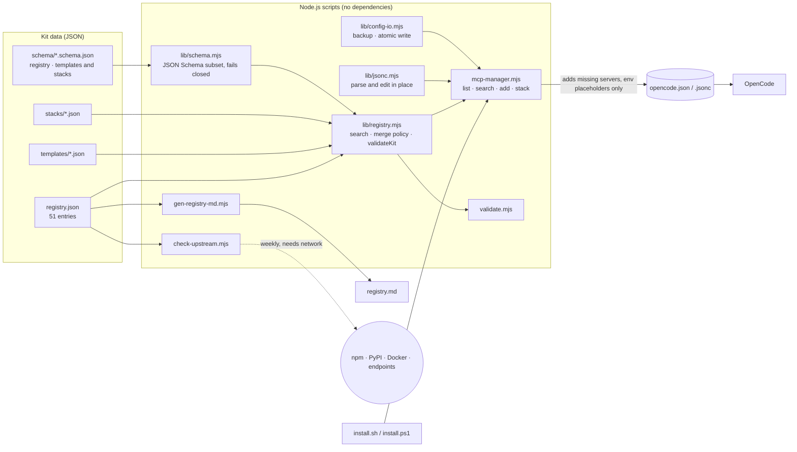

<p align="center">
  
</p>

<p align="center"><b>Curated MCP servers and one-command stacks for OpenCode</b></p>

<p align="center">
  <a href="LICENSE"></a>
  
  <a href="https://github.com/muhib-karim/opencode-superapp/actions/workflows/ci.yml"></a>
  <a href="https://github.com/muhib-karim/opencode-superapp/actions/workflows/upstream.yml"></a>
  <a href="registry.md"></a>
  <a href="docs/STACKS.md"></a>
  <a href="package.json">= 18"></a>
  <a href="package.json"></a>
  <a href="https://ko-fi.com/ai_dev_2024"></a>
</p>

[OpenCode](https://opencode.ai) is an AI coding agent for the terminal that works
with any model, including the free models on
[OpenCode Zen](https://opencode.ai/auth) (see [docs/FREE-MODELS.md](docs/FREE-MODELS.md)).
Out of the box it has no *tools*: no repo access, memory, live docs, web search or browser.
Those come from [MCP (Model Context Protocol)](https://modelcontextprotocol.io) servers.

**OpenCode SuperApp** fills that gap. It is a curated, validated registry of
**51 MCP servers** (37 local, 14 remote), grouped into **7 ready-made stacks**, plus a
**zero-dependency Node.js CLI** that adds them to your `opencode.json` without overwriting
anything of yours and without ever writing a secret to disk.

## Key features

- **Curated registry**: [`registry.json`](registry.json) describes each server (transport, command or URL,
  required env vars, category, stacks). A human-readable index, [registry.md](registry.md), is
  generated from it.
- **Standard templates**: one `templates/<id>.json` per server, in OpenCode's `mcp.<id>`
  [config format](https://opencode.ai/docs/mcp-servers/) (see [Limitations](#limitations-and-roadmap)
  for the newer `mcp.servers` layout).
- **7 stacks**: `superapp`, `web-dev`, `data-analysis`, `devops`, `ai-search`, `productivity` and `testing`.
  The `superapp` stack is 8 servers with no required API keys. The tests check that.
- **Searchable CLI** (`scripts/mcp-manager.mjs`): `list`, `search`, `add` and `stack`. It only
  adds servers you do not have yet. A server already in your config is kept as it is unless
  you pass `--force`, and no other key is touched.
- **Safe writes**: your config is edited in place, so comments and formatting survive. The
  previous version is backed up first and the new one is written atomically. Details in
  [What the installer does to your config](#what-the-installer-does-to-your-config).
- **Secret hygiene**: templates use only `{env:VAR}` placeholders. The installer prints
  `export` hints and never writes key values. The validator rejects literal credentials and
  token-shaped strings (GitHub, Slack, AWS, Stripe, GitLab, `sk-` keys, private keys) in the
  registry, templates, stacks and the example config.
- **Schema-validated**: `registry.json` is checked against a
  [JSON Schema](schema/registry.schema.json), and every template and stack against
  [another](schema/config.schema.json). Each template must equal its registry entry and each
  stack entry must equal its template. Counts are measured from the files, not hardcoded.
- **Cross-platform installers**: `install.sh` (macOS/Linux/WSL) and `install.ps1` (Windows
  PowerShell 5.1 and PowerShell 7), each with an interactive menu.
- **Upstream check**: `npm run check:upstream` verifies that every package still exists on
  npm, PyPI, Docker Hub or GHCR and that every remote endpoint still answers. CI runs it weekly.

## Demo

A terminal session rendered to SVG from command output. It was recorded at v1.0.0; the
commands print the same today, and the test suite has grown since:

<p align="center"></p>

## Quick start

**1. Install OpenCode** (see the [OpenCode docs](https://opencode.ai) for other methods):

```bash
curl -fsSL https://opencode.ai/install | bash   # macOS / Linux
npm install -g opencode-ai                       # any OS with Node
```

**2. (Optional) connect free models:** sign in at [opencode.ai/auth](https://opencode.ai/auth),
then in the OpenCode TUI run `/connect` → OpenCode Zen, and `/models` to browse.
Details and the current model list: [docs/FREE-MODELS.md](docs/FREE-MODELS.md).

**3. Install the kit.** The kit itself needs only Node.js 18 or later and has no npm
dependencies:

```bash
git clone https://github.com/muhib-karim/opencode-superapp.git
cd opencode-superapp

./install.sh --superapp        # macOS / Linux / WSL  (or ./install.sh for the menu)
# .\install.ps1 -Superapp      # Windows PowerShell   (or .\install.ps1 for the menu)
```

This adds 8 servers to `./opencode.json` (or pass `--config <path>` / `--global`). If the
file already exists, anything in it is kept:

| Tool | Your agent can now… |
|---|---|
| `filesystem` | read/write/search your project |
| `memory` | keep a knowledge graph across sessions |
| `sequential-thinking` | reason step by step on hard problems |
| `fetch` | turn any URL into markdown |
| `time` | get correct dates and timezones |
| `context7` | pull current docs for a library |
| `gh_grep` | search public GitHub code for real examples (grep.app) |
| `playwright` | drive a real browser: click, fill, screenshot |

The servers bring their own runtimes. Six of these run through `npx`. `fetch` and `time` are
the official Python reference servers, so they also need [`uv`](https://docs.astral.sh/uv/)
(`uvx`) on your PATH. Other stacks use `uvx` and Docker too; `search <id>` shows the command.

Verify inside OpenCode with `opencode mcp list`.

## Usage

```bash
node scripts/mcp-manager.mjs --help                     # usage
node scripts/mcp-manager.mjs list                       # all 51 servers
node scripts/mcp-manager.mjs list --stack devops        # servers in a stack
node scripts/mcp-manager.mjs list --type remote --json  # machine-readable
node scripts/mcp-manager.mjs search postgres            # search id/title/description/category
node scripts/mcp-manager.mjs stack web-dev              # add a whole stack to ./opencode.json
node scripts/mcp-manager.mjs add github sentry --global # ~/.config/opencode/opencode.json
node scripts/mcp-manager.mjs add github --config ./my.json
node scripts/mcp-manager.mjs stack devops --dry-run     # show what would be added, write nothing
node scripts/mcp-manager.mjs add github --force         # replace your existing github entry
```

npm script shortcuts: `npm run superapp`, `npm run list`, `npm run search -- <q>`, `npm run stack -- <name>`,
`npm run add -- <id...>`.

| Stack | Servers | What it adds |
|---|---|---|
| ⭐ `superapp` | 8 | the keyless essentials above |
| `web-dev` | 14 | git, github, browsers, figma, vercel, netlify, shadcn, supabase, docs |
| `data-analysis` | 10 | postgres, sqlite, mysql, mongodb, redis, supabase, prisma, neon, memory |
| `devops` | 12 | docker, kubernetes, terraform, aws-docs, azure, cloudflare, digitalocean, grafana, datadog, sentry |
| `ai-search` | 10 | brave, tavily, exa, firecrawl, fetch, context7, gh_grep, youtube-transcript |
| `productivity` | 9 | slack, discord, linear, notion, jira, confluence, google-drive, obsidian |
| `testing` | 8 | playwright, puppeteer, chrome-devtools, firecrawl, everything (reference server), [agent-qa](https://vostride.com) |

Stacks combine: run the command again with another stack and the new servers are added. Full details are in [docs/STACKS.md](docs/STACKS.md).

When a server needs credentials, the installer prints what to set in your shell. Values are never written to JSON:

```bash
export GITHUB_PERSONAL_ACCESS_TOKEN="..."      # bash/zsh
$env:GITHUB_PERSONAL_ACCESS_TOKEN="..."        # PowerShell
opencode mcp auth sentry                       # OAuth remote servers
opencode mcp debug <name>                      # when something fails
```

## What the installer does to your config

`add` and `stack` are built so that running them cannot cost you anything:

- **Your entries win.** A server id that is already in your config is left exactly as it is,
  even if it differs from the template. `--force` replaces it.
- **Nothing else is touched.** The file is edited in place. Comments, trailing commas,
  indentation, key order and line endings are preserved, in `opencode.json` and
  `opencode.jsonc` alike. `$schema` is only written into a file the command creates.
- **A backup first.** The previous version is copied to `<file>.bak`, then `.bak.1`, `.bak.2`
  and so on. An earlier backup is never overwritten, so delete them when you are done.
- **All or nothing.** The new content goes to a temporary file that is renamed into place. An
  interrupted run cannot leave a half-written config.
- **Refusals instead of guesses.** A file that is not valid JSON or JSONC, is not UTF-8, is
  read-only, or whose root or `mcp` is not an object, is left untouched with a one-line
  error. Errors give a line and column and never quote the file.
- **No secrets.** Only `{env:VAR}` placeholders are written.

`--dry-run` shows what would be added without writing. A mistyped option is an error, not
something silently ignored.

### Five rules that prevent most failures

1. Keep secrets in the shell (`{env:VAR}`), never in JSON. See [docs/TROUBLESHOOTING.md](docs/TROUBLESHOOTING.md).
2. Use `environment` for **local** servers and `headers` for **remote** servers. Swapping them is the most common cause of a 401.
3. Key-based remotes need `"oauth": false`. OAuth remotes need `"oauth": {}` plus `opencode mcp auth <name>`.
4. Keep to about 8 servers per session, and turn heavy ones on per agent (see `opencode.example.json`).
5. Run `npm run validate` after every hand-edit.

## Architecture



- **Data**: `registry.json` is the catalog and the single description of each server.
  `templates/` holds the config entry each record stands for, and the validator requires the
  two to match. `stacks/` holds named sets of servers; these files decide what `stack`
  installs and what `list --stack` shows, and each entry must equal its template.
- **Library**: `scripts/lib/` holds small modules with no dependencies. `schema.mjs` is a
  JSON Schema subset validator that throws on any keyword it does not implement.
  `registry.mjs` has the registry helpers, the merge policy and the kit validator.
  `jsonc.mjs` parses JSON with comments and splices new servers into the text.
  `config-io.mjs` finds the config file, backs it up and replaces it atomically.
- **Scripts**: `mcp-manager.mjs` is the CLI. `validate.mjs` checks the kit's own data.
  `gen-registry-md.mjs` generates `registry.md`. `check-upstream.mjs` is the only script that
  uses the network.
- **Installers**: thin shell and PowerShell wrappers around the CLI.

## Testing

```bash
npm run validate         # schemas, cross-file consistency and secret scan of the kit's data
npm test                 # node:test suites; no install step, no network
npm run check:registry   # registry.md is what the generator produces
npm run check:upstream   # network: every package and endpoint still exists
```

The tests use Node's built-in `node:test` runner. They cover:

- the schema validator, including the rule that an unsupported keyword is an error;
- the kit validator on damaged temporary copies of the kit, one negative case per rule
  (template or stack drift, stack membership, placeholders, literal credentials, token-shaped
  strings, malformed files);
- the merge policy: existing servers are kept, `--force` replaces, bad configs are refused;
- the in-place editor, with exact expected output for comments, trailing commas, tabs, CRLF,
  a BOM, minified files and duplicate keys;
- backups, atomic replacement, symlinks, file modes and concurrent changes;
- the real CLI run as a child process, including error messages and exit codes;
- `install.sh` run for real, and `install.ps1` statically plus under `pwsh` where it is installed;
- the `registry.md` generator, the CI workflow policy, and every count quoted in the docs.

CI ([`.github/workflows/ci.yml`](.github/workflows/ci.yml)) runs on every push to `main` and
every pull request: the validator, `check:registry` and the tests on Node 18, 20, 22 and 24;
the tests and `install.ps1` on Windows under PowerShell 5.1 and 7; shellcheck and
PSScriptAnalyzer; and gitleaks over the full history. Actions are pinned to commit SHAs.
[`upstream.yml`](.github/workflows/upstream.yml) runs `check:upstream` weekly.

## Project structure

```
.
├── registry.json            # catalog of 51 MCP servers
├── registry.md              # human-readable index, generated from registry.json
├── schema/                  # JSON Schemas: registry.json, and templates/stacks
├── templates/               # one opencode.json snippet per server (51)
├── stacks/                  # 7 named server bundles
├── scripts/
│   ├── mcp-manager.mjs      # CLI: list / search / add / stack
│   ├── validate.mjs         # schema + consistency validator
│   ├── gen-registry-md.mjs  # generates registry.md (--check for CI)
│   ├── check-upstream.mjs   # network check of packages and endpoints
│   └── lib/                 # registry, schema, jsonc, config-io, registry-md, upstream, errors
├── test/                    # node:test suites
├── install.sh / install.ps1 # one-click installers
├── opencode.example.json    # per-agent tool gating example
├── .github/workflows/       # ci.yml (push, PR) and upstream.yml (weekly)
└── docs/                    # STACKS, FREE-MODELS, TROUBLESHOOTING, banner, demo
```

## Limitations and roadmap

- The kit installs *configuration*. Whether a server actually starts depends on its own
  runtime (`npx`, `uvx` or Docker) and credentials. Run `opencode mcp list` / `opencode mcp debug <name>` to check.
- `npm test` does not use the network. Whether packages and endpoints still exist is checked
  by `npm run check:upstream`, weekly in CI. It proves they exist, not that they work with
  your credentials.
- Five servers use packages that npm marks as deprecated or archived upstream: `gitlab`,
  `postgres`, `puppeteer`, `brave-search` and `google-drive`. They still install; replacing
  them is on the roadmap.
- The kit writes servers under `mcp.<id>`. Current OpenCode documents a newer layout,
  `mcp.servers.<id>`, and still accepts the older one. A config that already uses
  `mcp.servers` is refused rather than mixed. Writing the newer layout is on the roadmap.
- Backups (`.bak`, `.bak.1`, …) are never deleted for you.
- The free-model list in [docs/FREE-MODELS.md](docs/FREE-MODELS.md) may change on OpenCode's side.

## Contributing

You can add a server in about 10 minutes. The checklist is in [CONTRIBUTING.md](CONTRIBUTING.md).
Please redact all secrets in bug reports. Security issues: [SECURITY.md](SECURITY.md).

## Support

If this kit helped you, you can [buy me a coffee on Ko-fi](https://ko-fi.com/ai_dev_2024).

## License

[MIT](LICENSE). Not affiliated with OpenCode/Anomaly. The config format follows the
[official MCP docs](https://opencode.ai/docs/mcp-servers/).
